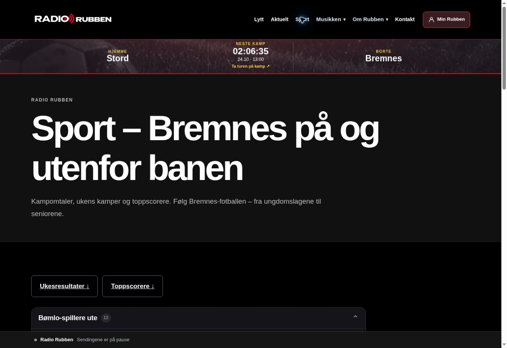

# Sport, fast kampmal og korte kampreferater – produksjonskvittering

Status: **utrullet 24. oktober 2026 etter uttrykkelig brukergodkjenning**. Ingen artikler er generert eller publisert av denne leveransen. Ingen merge til main.

Leservei kontrollert i produksjonsnettleser: Forsiden → **Sport** → **Ukesresultater**. URL: https://www.radiorubben.no/sport/#rr-weekly-results. Oversikten viser korrekt «Ingen ukesresultater er publisert ennå» så lenge ukesoppsummeringen er et utkast.

## Installert omfang og kvitteringer

| Leveranse | Kilde / manifest SHA-256 | Resultat |
| --- | --- | --- |
| Åtte pluginfiler fra PR #108 | Kilde `10e9684d6061deccc9bdd5ac39d3cf8251f4bfc4`; manifest `ae4b64f885b5f2ff4414237aaad17c7c21b4e677206bc4dd03f023f004304d47` | [Kjøring 40078934117](https://github.com/toystad461/radiorubben-web/actions/runs/40078934117), bestått 08:41 UTC; 48 kontrollerte stier |
| Sport-side 769 og WordPress-meny 58 | Samme kjøring; hashbundet navigasjonsplan og separat privat side-/menybackup | Gammel statisk uke 38-blokk erstattet med `[rrfr_weekly_results]`; snarvei oppdatert; nytt menyelement 1538 |
| Faktisk hovedmeny i aktivt tema | Kilde `ee03524ef67f3d43acc5abf902938fc17caaac86`; manifest `a1f1d1b458a4b223729ee016721637c4dc1d2aade30f6f409d15b175829bed70` | [Kjøring 40079481795](https://github.com/toystad461/radiorubben-web/actions/runs/40079481795), bestått 08:49 UTC; 49 kontrollerte stier |

Den faktiske forsiden leser en egen menymal, ikke WordPress-meny 58. Visuell etterkontroll avdekket dette. Den allerede godkjente Sport-aktiveringen ble derfor fullført med én ekstra fil: `wp-content/themes/radio-rubben-next/template-parts/site/navigation.php`, kun en Sport-lenke etter Aktuelt. Før-hash `45cdd7bd72f1894a1be9d1d61559f7d60d5323fd84596b19b2d1b533f529b53b`; etter-hash `47797edd8fcf896489f046a159df8ec5474de246c2d7cb0cb13cc406a3685029`. Eksisterende navigasjon ble beholdt.

Side 769 fikk innholdshash `c2fcf8b0da62215fef77bfd30e2cc959fa2ca7c00ef31d6ed506f1313058a621` og endringstid 08:40:47 UTC. Øvrig sideinnhold, metadata og kontrollerte sidefelt ble bevart. Toppscorere, spilleroversikt og eksisterende artikler er fortsatt tilgjengelige.

## Kontroll og redaksjonelle grenser

- Kandidatens [CI 40076214834](https://github.com/toystad461/radiorubben-web/actions/runs/40076214834): 69 PHP-filer, 30 isolerte suiter, 24 kontroller i disponibel WordPress 7.1.3/MySQL og Chromium ved 320, 390 og 1280 piksler.
- [Forhåndskontroll 40078232302](https://github.com/toystad461/radiorubben-web/actions/runs/40078232302): produksjonens 48 før-hasher, 61 installasjons-/tilbakeføringskontroller og reell test av side-/menyinstallasjon og tilbakeføring. Temaets installasjon bestod 62 tilsvarende kontroller og native PHP-syntakskontroll.
- Begge vellykkede installasjoner sammenlignet private før-/etterfingeravtrykk byte for byte: innlegg, vedlegg, artikkel-/bildemetadata, taksonomitilknytninger, fotballrobotens innstillinger uten midlertidige låser og Studio-køfilen var identiske.
- Nyhetsdesken lastet uten dobbeltdefinisjon av bildekontrakten; bildekatalogens 21 oppføringer ble kontrollert. Studio og WordPress bruker fortsatt de identiske, tidligere installerte kontraktene.
- Publisert innlegg 1398 og utkast 1467 med hovedbilde 812 ble kontrollert. Utkastet er ikke migrert eller publisert. Faktisk ReviewDesk-rendering ble kontrollert etter WordPress-sanitering; CSS vises ikke som artikkeltekst i den nye visningen.
- Ukesarkivet skjuler utkast. Anonyme forespørsler til de nye redaksjonelle endepunktene avvises med 403. Ingen AI-kall, generering, nye godkjenninger eller publisering i installasjonen.
- HTTP-kontroll verifiserte Sport-lenken inne i `nav#rr-primary-nav` og rendret ukesoversikt. Nettleserkontroll bekreftet klikk fra forsiden via Sport til ukesresultatene. Fysisk iPhone/Safari er ikke testet.
- Vedlikeholdsmodus og egne midlertidige låser ble fjernet etter begge vellykkede installasjoner. Ingen varig endring av cron, schedulerpin eller Studio-innstillinger. PR #106 er ikke del av leveransen.

## Sikkerhetskopi og tilbakeføring

Private kopier ligger utenfor webroten; de skal ikke lastes opp til GitHub:

1. Åtte filer, navigasjon og tilstand: `/home/cptk37ymg_w1417156/.radiorubben-deploy/backups/match-stories-sport-20261024T084035Z-ae4b64f885b5`.
2. Temameny og tilstand: `/home/cptk37ymg_w1417156/.radiorubben-deploy/backups/sport-menu-theme-20261024T084846Z-a1f1d1b458a4`.

Installeringspakkene ble opprettet under `.radiorubben-deploy/sport-<run-id>-<commit>` for henholdsvis `40078934117-230ce4991c424240073504f4affbe775fceb7fbb` og `40079481795-ee03524ef67f3d43acc5abf902938fc17caaac86`. Bruk tilhørende pakke, manifest og backup sammen.

Ved full tilbakeføring: ta eksisterende deploy-/scheduler-/Studio-låser, bruk samme kontrollerte vedlikeholds- og jobblåssekvens som installasjonen, og ta et nytt tilstandsfingeravtrykk. Rull først tilbake temafilen med temapakkens `scripts/install.php <pakke> <backup> rollback`. Rull deretter tilbake side-/menyendringen med den opprinnelige pakkens `navigation.php` (`RR_SPORT_NAV_ACTION=rollback`, `RR_SPORT_STAGE`, `RR_SPORT_BACKUP`), og til slutt de åtte filene med den opprinnelige pakkens installer i `rollback`-modus. Kontroller før-hasher, side/meny og offentlig visning, tøm eksisterende sidecache og frigjør bare egne låser før vedlikeholdsmodus deaktiveres.

Tilbakeføring nekter å overskrive fremmede filendringer, nye sideendringer eller endrede menyelementer. Den gjenoppretter kun denne leveransen; ingen full databaseimport eller tilbakestilling av redaksjonelle data. Dersom kontrollene stopper på nyere endringer, må disse avklares før videre tilbakeføring.

## Avbrutte forsøk og tiltak

To tidligere installasjonsforsøk rullet automatisk tilbake kode og navigasjon fordi samtidige bakgrunnsjobber endret henholdsvis kampoppfølging og Studio-kø. Artikler, vedlegg og godkjenninger var uendret. Bakgrunnsjobbenes egne oppdateringer ble bevart; ingen database ble tilbakestilt. Den endelige kjøringen brukte den eksisterende schedulerlåsen, faktisk Studio-arbeidslås, midlertidig egen kampoppfølgingslås og en kortvarig WordPress-cron-mutex. Den ventet på aktive jobber fremfor å avbryte dem, og den strenge før-/etterkontrollen bestod.

Andre forsøk stoppet før kodeendring: lint av en uutfylt sjablong, manglende `realpath`-kommando på verten, én ekstra linjeslutt i temaets Git-kandidat og en allerede aktiv cron-jobb. Disse ble løst med kontroll av den genererte sjablongen, PHPs `realpath`, eksakt bekreftet serverhash og begrenset venting. Ingen ukjent filvariant ble overskrevet.

Engangsjobben som installerte kode er nå erstattet av en **kun lesende** kontroll av alle 49 etter-hasher. Den strømmer en PHP-leser over eksisterende SSH, uten WordPress-bootstrap, filinstallasjon, databaseendring eller cachetømming. Historiske installasjonsmanifest og kvitteringer beholdes.

## Neste redaksjonelle steg

Utkast 1467 kan flyttes til den faste malen gjennom den eksplisitte redaksjonelle handlingen. Deretter kan korte kampreferater klargjøres og vurderes enkeltvis, med kampkort øverst og faktabasert tekst under. Eksisterende artikler gjenbrukes uten overskriving. Ukeskort kobles bare til publiserte referater med samsvarende fakta. Publisering krever fortsatt separat godkjenning; den er ikke gitt eller utført i denne leveransen.
